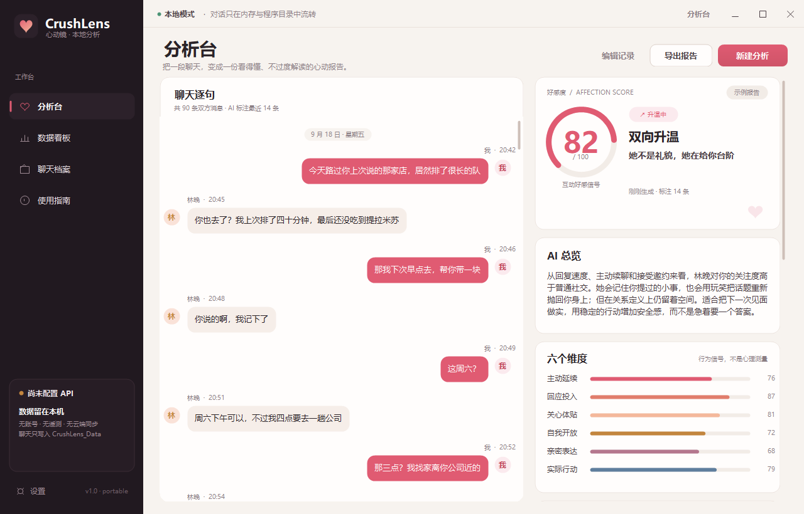
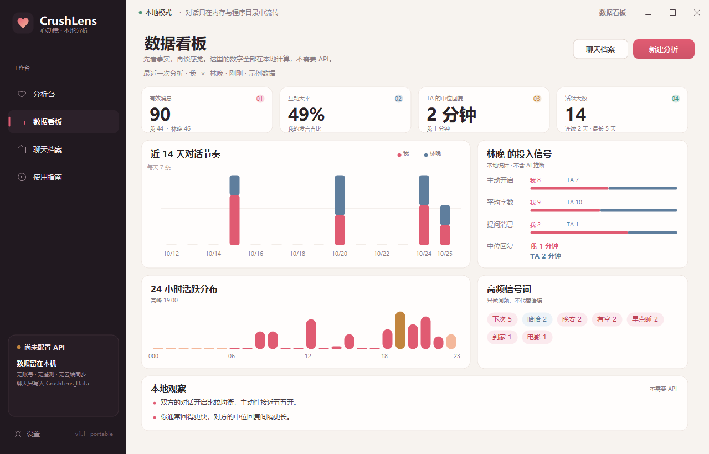
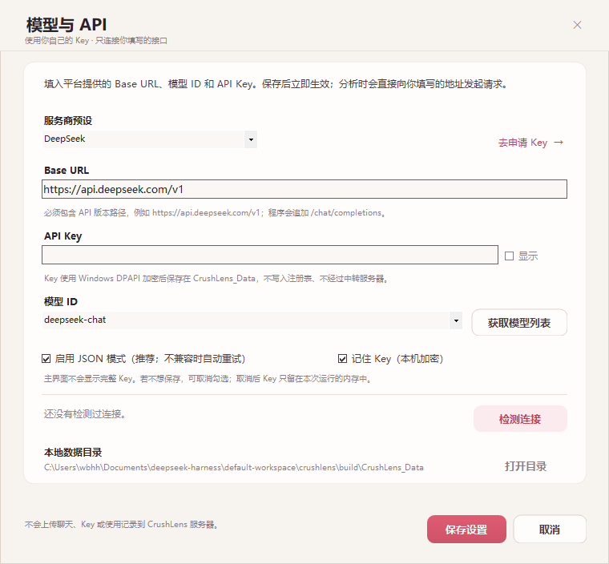

# CrushLens 心动镜 · v1.0

> 本地优先的聊天好感度分析工具。一个绿色、便携的 Windows exe，不需要安装，不写注册表，不上传聊天到任何 CrushLens 服务器。



CrushLens 用两套东西一起读懂一段对话：一套完全在本机计算的聊天统计，一套由**你自己配置的 API Key** 驱动的 AI 行为分析。前者让你看到事实，后者帮你把事实翻译成可执行的下一步。

它不是读心术，不是关系判决书，也不提供 PUA 或操控话术。分数是**聊天中呈现出的互动好感信号**，不是“对方喜欢你的概率”。

| 数据看板（本地统计，不需要 API） | 模型与 API 设置（Key 手动接入） |
| --- | --- |
|  |  |

> 截图使用示例/模拟数据；不包含真实 Key 或真实聊天。

## 下载

- [GitHub Releases](https://github.com/Him-Wang/CrushLens/releases/latest)
- [直接下载 CrushLens.exe](https://github.com/Him-Wang/CrushLens/releases/latest/download/CrushLens.exe)
- [下载便携包](https://github.com/Him-Wang/CrushLens/releases/latest/download/CrushLens-1.0.0-portable.zip)
- [下载完整源码包](https://github.com/Him-Wang/CrushLens/releases/latest/download/CrushLens-v1.0.0-source.zip)

Release 中的 `SHA256.txt` 可用于核对文件完整性。

---

## 1. 为什么是它

- **绿色便携**：只需要一个 `CrushLens.exe`；数据写在 exe 同级的 `CrushLens_Data`，不安装、不主动写注册表或 AppData、不注册服务/计划任务。
- **Key 由你手动接入**：内置 DeepSeek、通义千问、Kimi、智谱、硅基流动、OpenAI、OpenRouter 等 OpenAI 兼容预设；也可以填任意兼容 Base URL 和模型 ID。程序不附带任何 Key。
- **本地统计先看事实**：消息量、互动天平、主动开启、中位回复、平均字数、提问数、24 小时活跃、14 天节奏、高频信号词。这些不需要 API。
- **AI 报告而不只是分数**：0–100 好感信号、六个行为维度、具体心动信号、需要留心的地方、回复表现评级、下一句建议，以及最近一段消息的情绪/意图标签。
- **微信式聊天阅读**：保留双人上下文，AI 标注直接显示在消息下方，不拿“总结”替代原文。
- **本地档案与 HTML 导出**：分析完成自动存到本机；可导出排版好的独立 HTML 报告，用浏览器打开或打印为 PDF。
- **隐私边界清楚**：唯一的联网行为是向你填写的 API 地址发送本次分析节选；没有遥测、检查更新或云端账号。

## 2. 快速开始

### 环境

- Windows 10 / 11（x64 或 x86）。
- 系统自带或已安装 **.NET Framework 4.8**（Windows 10 1903+ / Windows 11 通常已包含）。
- 一个可用的 OpenAI 兼容 API Key，或者本机模型服务（如 Ollama、LM Studio）。

### 三步

1. 将 `CrushLens.exe` 放进一个**可写**的普通文件夹（U 盘、D 盘便携目录、桌面均可）。建议整个文件夹一起移动，方便带走档案。
2. 双击 `CrushLens.exe` → 左下角「设置」→ 选择预设或「自定义 / 本机接口」→ 填 Base URL、模型 ID、API Key → 点「检测连接」→ 保存。
3. 回到分析台，粘贴聊天或导入 `.txt` / `.json`，选择「我是 / 对方是」与关系阶段，点击「开始分析」。

> `CrushLens_Data` 会在 exe 同级自动生成。它包含设置、加密后的 Key、聊天档案和错误日志。删除这个文件夹等于清空全部本地数据。

### 首次配置参考

| 平台 | Base URL 示例 | 模型 ID 示例 |
| --- | --- | --- |
| DeepSeek | `https://api.deepseek.com/v1` | `deepseek-chat` |
| 通义千问 · 百炼 | `https://dashscope.aliyuncs.com/compatible-mode/v1` | `qwen-plus` |
| Kimi · Moonshot | `https://api.moonshot.cn/v1` | `moonshot-v1-8k` |
| 智谱 GLM | `https://open.bigmodel.cn/api/paas/v4` | `glm-4-flash` |
| 硅基流动 | `https://api.siliconflow.cn/v1` | `deepseek-ai/DeepSeek-V3` |
| OpenAI | `https://api.openai.com/v1` | `gpt-4o-mini` |
| OpenRouter | `https://openrouter.ai/api/v1` | 按平台模型列表填写 |
| 本机 Ollama | `http://127.0.0.1:11434/v1` | 你本机已拉取的模型名 |

模型名会随平台更新，**以控制台「获取模型列表」和你账号实际可用的模型为准**。Base URL 需要包含 API 版本路径；程序会在其后追加 `/chat/completions`。

## 3. 支持的聊天格式

粘贴到输入框，或拖入 `.txt` / `.json` 文件。只分析你选择的两个人，其他群成员会被跳过。

**微信电脑版三行格式**

```text
林晚
2026年9月20日 21:14
在吗

我
2026年9月20日 21:15
在的
```

**微信 / 通用「昵称 + 时间 + 正文」**

```text
林晚: 2026-09-20 21:14 在吗
我: 2026-09-20 21:15 在的
```

**QQ**

```text
林晚: 09-17 19:26:53
晚上好
我: 09-17 19:27:00
晚上好呀
```

**WhatsApp 导出文本**

```text
[9/17/26, 7:26:53 PM] Alex: Dinner tonight?
[9/17/26, 7:27:00 PM] Me: Sounds good
```

或：

```text
17/09/2026, 19:26 - Alex: Dinner tonight?
17/09/2026, 19:27 - Me: Sounds good
```

**JSON**

支持数组，或包含 `messages` / `chat` / `data` 数组的对象。每条消息可使用这些字段：

- 发送人：`sender` / `senderName` / `from` / `name` / `author` / `nickname` / `speaker`
- 内容：`content` / `text` / `message` / `body` / `msg`
- 时间：`timestamp` / `time` / `date` / `createdAt` / `createTime` / `sendTime` / `ts`

也支持 `[发送人, 内容, 时间]` 形式的数组项。图片、语音、视频和文件目前只作为文本占位符，不做 OCR 或转写。

## 4. 它是怎么算的

**本地统计（不需要 API）**

- 有效消息、双方占比、活跃天数、连续聊天天数
- 按间隔 > 3 小时切分的对话开启次数
- 中位回复时间（0–6 小时内的回复）
- 平均字数、提问数、连续追发、深夜消息、24 小时分布
- 14 天对话节奏、信号词频
- 这些指标直接决定看板上的事实，不经过模型

**AI 报告（需要 API）**

- 每次默认取最近 **120 条**（可在分析台切换 80 / 120 / 200 条），过长的内容会做等距抽样；本地统计仍覆盖全部所选两人的消息。
- 模型返回严格 JSON，再由程序校验分数、维度与标签编号。格式不合法时最多自动重试一次；不支持 JSON 模式的接口会自动改用普通模式重试。
- 评分关注：主动延续、回应投入、关心体贴、自我开放、亲密表达、实际行动。
- 明确拒绝、回避、边界表达会进入「需要留心」，而不是被包装成“还有机会”。
- AI 输出有随机性，不同模型与不同时间会给出不同结果。请把它当作一次结构化复盘，而不是结论。

## 5. 数据与隐私

| 项目 | 说明 |
| --- | --- |
| 存放位置 | 仅 exe 同级的 `CrushLens_Data/` |
| `settings.json` | 配置；Key 以 Windows DPAPI 加密，绑定当前 Windows 用户 |
| `sessions/*.json` | 聊天原文、报告、本地统计 |
| `exports/` | 你主动导出的 HTML |
| `app.log` | 错误日志；不主动记录聊天原文 |
| 网络请求 | 仅你配置的 API 地址；没有 CrushLens 中转、遥测、账号或检查更新 |
| 注册表 / AppData / 服务 | 程序自身不写入、不注册；DPAPI 的系统主密钥由 Windows 管理 |
| 导出报告 | 可能包含报告中的原文引用；导出由你主动触发 |

**换电脑或换 Windows 用户后，DPAPI 加密的 Key 无法解密，需要重新填写。** 聊天档案本身是普通 JSON，自己复制 `CrushLens_Data/sessions` 即可迁移。

> 如果 exe 位于 C 盘，数据自然也在 C 盘；这是“数据在程序旁边”的便携设计，不是安装残留。若不想在系统盘留文件，把整个程序文件夹放到 D 盘或 U 盘即可。程序不会退回到 AppData 偷偷写数据。

## 6. 边界

- 不读取微信 / QQ 数据库，不后台监听，不自动抓取聊天记录。你粘贴什么，它才看什么。
- 不支持图片 OCR、语音转写、ZIP / HTML 聊天包。
- 不做心理诊断，不预测表白成功率，不替代面对面沟通。
- 不建议用分数给关系下判决，更不建议用它设计试探、操控或“拿捏”对方。
- 如果对方明确拒绝、表达不适或要求停止，请尊重边界。这比任何分数都重要。
- AI 可能出错、遗漏或过度推断。涉及钱、隐私、人身安全时，不要依赖本工具。
- 由于没有购买代码签名证书，Windows SmartScreen 可能提示“未知发布者”。可核对 SHA256，或从随附源码自行编译。

## 7. 源码与构建

源码就在本仓库中，MIT 许可，独立实现。

```powershell
# 需要 Windows 自带的 .NET Framework 4.8 编译器；无需 Node、Python 或安装 SDK
.\build.ps1
```

产物在 `build/CrushLens.exe`。

技术栈：C# / WinForms / .NET Framework 4.8，HTTP 使用 `System.Net.Http`，JSON 使用 `System.Web.Extensions`，API Key 使用 DPAPI，报告导出为独立 HTML。

## 8. 灵感来源

产品思路参考了两个优秀的开源项目，但 CrushLens 的界面与代码为独立编写，不是它们的官方版本，也未复制其源码：

- [Crush Monitor](https://github.com/FerryCorleone/crush-monitor) — 微信风格聊天 + 情绪/意图 + 好感度与回复评级
- [ChatLab](https://github.com/ChatLab/ChatLab) — 本地优先的聊天记录分析、可视化与桌面应用体验

## 9. 许可

MIT。详见 [LICENSE](LICENSE)。

---

**CrushLens 不上传你的聊天到自己的服务器。分析所需的节选会发送到你配置的模型服务商；是否使用、使用哪个服务商，由你决定。**
