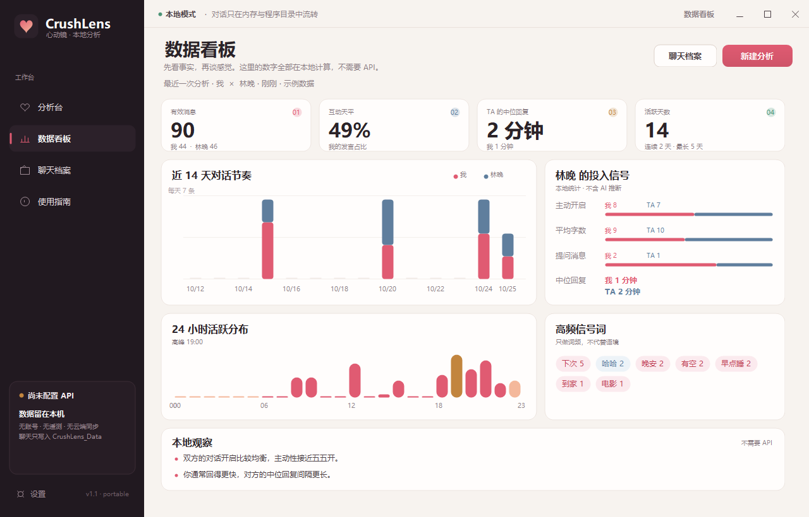
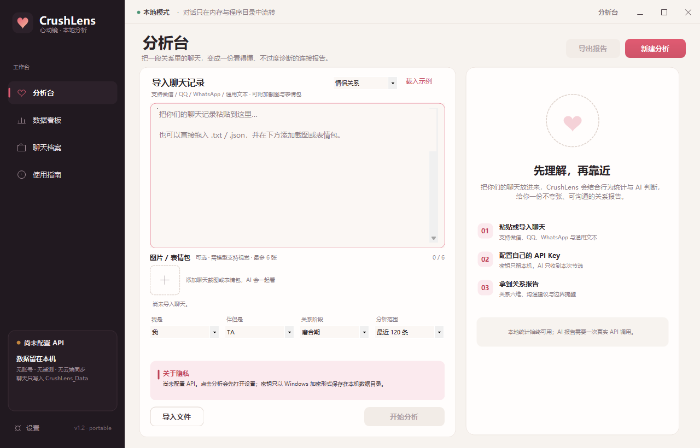
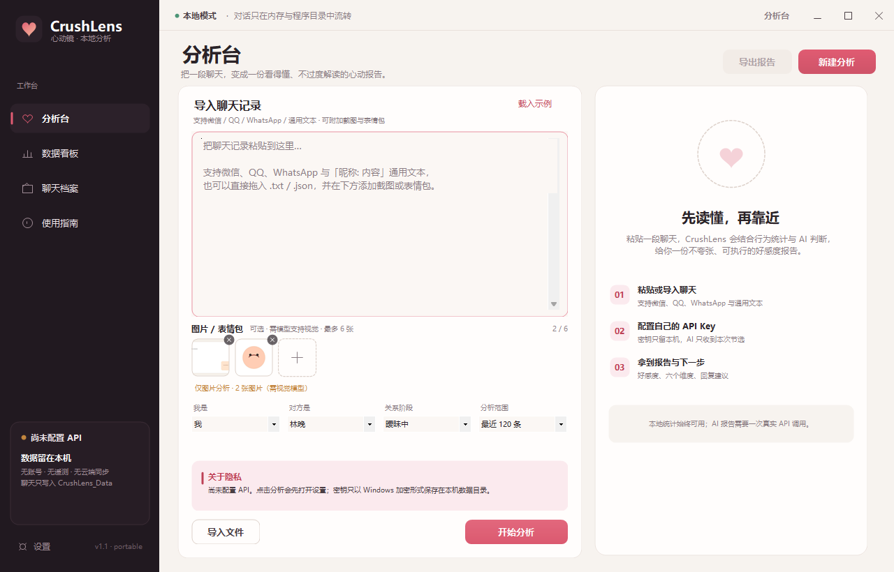

# CrushLens 心动镜 · v2.0

> 本地优先的聊天情感浓度追踪工具。把一段对话整理成一条看得见的时间线——分数、曲线、转折点、复盘，全部在你自己设备上算。
>
> **在线版（免安装，手机可用）**：[https://him-wang.github.io/CrushLens/](https://him-wang.github.io/CrushLens/)　·　源码在 [`web/`](web/)，由 GitHub Actions 自动发布
> **桌面版（Windows exe，v1.2）**：见 [下载](#桌面版windows) 与 [GitHub Releases](https://github.com/Him-Wang/CrushLens/releases)

它不是读心术，也不是关系判决书。分数是**聊天里本来就存在的互动信号**（主动、回应、关心、亲密、开放、行动）的整理结果，不是"对方喜欢你的概率"，不提供 PUA 或操控话术。

---

## 1. v2.0 是什么

v1.x 是一套 Windows 桌面程序：一个 exe，自己填 API Key，由模型给分。
v2.0 是**另一套实现**，从零重写的浏览器版本：没有后端、没有 API Key、不需要安装，分数全部由本地引擎算出来。

两套东西并存、互不影响，数据也不互通。

| | **在线版 v2.0**（`web/`） | 桌面版 v1.2（exe） | legacy v1.3（[`legacy/index.html`](legacy/index.html)） |
| --- | --- | --- | --- |
| 形态 | 浏览器页面，免安装 | Windows exe，绿色便携 | 单个 HTML 文件 |
| 手机 / 平板 | ✅ | ❌ | 勉强 |
| 要不要 API Key | **不要**，本地算 | 要，自己填 | 要，自己填 |
| 分数来源 | 本地引擎（确定性，可单测） | 模型 + 六维加权校准 | 模型 |
| 数据存放 | 浏览器 IndexedDB | exe 同级 `CrushLens_Data/` | localStorage |
| 适合 | 长期追踪、多对象、跨设备形态 | 想用多模态模型读截图/表情包 | 只想双击打开 |

在线版是现在的主线，桌面版继续可用但不再加新功能。

---

## 2. 在线版：三步开始

1. 打开 [https://him-wang.github.io/CrushLens/](https://him-wang.github.io/CrushLens/)
2. 注册一个本机账号（邮箱 + 密码，只存在你浏览器里）
3. 「导入记录」→ 粘贴聊天，或拖入 `.txt` / `.json`，或截图识别，或走「直连本机」

想连本机聊天记录文件，用「直连本机」：下载 `assistant/启动助手.bat` 和 `assistant/连接助手.ps1` 放同一文件夹，双击启动，窗口里出现 6 位**配对码**；回网页输入配对码即可。之后它每 20 秒看一眼投递箱，有新的就提醒你导入。

> 必须用 `https://` 或 `http://localhost` 打开。直接双击 html（`file://`）时浏览器不提供 WebCrypto，注册会被明确拒绝——我们宁可拒绝，也不用弱哈希凑合，否则换个环境就登不进自己的账号。

开发端监管台在 [`/admin.html`](https://him-wang.github.io/CrushLens/admin.html)：**只对白名单里的 GitHub 账号开放**，由 Worker 服务端校验（前端绕不过去）。没连云端时退回本机模式，第一个认领的账号成为**本机唯一**的总开发者。

白名单写在 `worker/index.js` 的 `ADMIN_GITHUB_IDS`，用不可变的 GitHub 数字 id（login 能改名，id 不能）：

| 账号 | GitHub id |
| --- | --- |
| [@Him-Wang](https://github.com/Him-Wang) | `106427909` |
| [@1102-seven](https://github.com/1102-seven) | `355639050` |

要加人不必改代码：给 Worker 加环境变量 `ADMIN_GITHUB_IDS`（逗号分隔，带不带 `gh_` 前缀都行）即可追加。`OWNER_EMAIL` 仍作兼容通道——邮箱命中的账号同样算 admin，避免老部署把自己锁在门外。


---

## 3. 在线版能做什么

**情感浓度追踪**

- 逐日 0–100 打分，14 / 30 / 90 天区间切换，7 日均线抹平噪音
- 转折点自动标记（只在两侧都有足够真实观测日时才判，不会把"隔了一个月没聊"当成暴跌）
- 未来 7 天预测带置信区间；真实观测不到 3 天就不给预测

**复盘与六维**

- 复盘卡片：峰值日 / 低谷日 / 升温降温 / 风险信号
- 六维：主动、回应、关心、开放、亲密、行动（雷达图 + 逐项得分）
- 明确拒绝、回避、边界表达、冷淡会进入「需要留心」，而不是被包装成"还有机会"

**导入**

- 微信（电脑版导出 / 手机合并转发）、QQ、钉钉、WhatsApp、通用 JSON
- 按聊天对象分组；同一份记录重复导入会自动跳过重复消息
- 截图识别：本地 OCR 判断左右气泡归属、提取内容与日期，图片不上传
- 直连本机：扫描投递箱里的聊天记录文件，按联系人聚合，一键导入，20 秒自动同步

**外观**

- 五套主题：玫瑰 / 雾蓝 / 抹茶 / 黄昏 / **夜间**，加「跟随系统」
- 选择会记住；没手动选过时跟随系统深浅色自动切换；首屏内联脚本防白闪

**其它**

- 「实时监测」：增量粘贴即时重算
- 「使用记录」：导入流水与报告快照
- 窄屏（手机）用抽屉式侧栏，遮罩 / `Esc` / 「收起」三路都能关

---

## 4. 数据与隐私（在线版）

| 项目 | 说明 |
| --- | --- |
| 存放位置 | 当前浏览器的 IndexedDB（账号、追踪对象、消息、批次、报告、审计） |
| 网络请求 | 没有聊天内容上传。连接包括：你授权的本机助手（`127.0.0.1:17321`），以及 v2.1 云端账号接口（默认 `https://crushlens-api.crushlens.workers.dev`，仅用于账号元数据，详见 §9.5）。另有**可选的匿名使用统计**（默认关闭、需你在「设置」里主动开启），只上报注册/登录/导入次数、平台类型、App 版本与时间，**不含聊天内容、邮箱、昵称** |
| 账号 | v2 离线版密码用 PBKDF2-SHA256 在本机哈希后存 IndexedDB；v2.1 云端版密码在浏览器拉伸（10 万次）后只把哈希交给 Worker，**明文密码不离开设备** |
| 换设备 / 清缓存 | 聊天数据只在本机，清缓存会丢且无法找回；云端只存账号元数据（邮箱、昵称、登录统计），**不存聊天记录**，也不提供聊天内容备份 |
| 不同地址 | `localhost:8080` 与 `127.0.0.1:8080` 是两个 origin，数据互不可见 |
| 监管台 | 数据来自**服务端 D1 的真实匿名上报**（不再只是本机 IndexedDB）；白名单开发者在「总览 / 使用分析」看到真实用户规模与用量，并可将汇总快照镜像到 GitHub 仓库。未登录/未连云端时退回本机演示视图 |

**连接助手是本项目唯一会接触本机文件的部分**，安全模型：

| 风险 | 处理 |
| --- | --- |
| 任意网页通过 `fetch('127.0.0.1:17321')` 读本机聊天 | 启动时生成随机 Token，所有 `/api/*` 校验 `X-Bridge-Token`；网页先用 6 位配对码换 Token |
| CORS 全开导致浏览器变成攻击跳板 | 精确 Origin 白名单（本站域名 + `localhost`），非白名单一律 403；`Allow-Private-Network` 只对白名单返回 |
| 联系人接口泄露本机绝对路径 | 对外只给不可逆的短 id，真实路径留在助手内存里 |
| 被恶意网页一键关掉助手 | `/api/shutdown`、`/api/open-inbox` 改 POST + Token |
| 默认翻遍桌面 / 下载目录 | 默认只扫投递箱（`文档\心动镜导入`）；扩大范围需显式用 `-ScanUserFolders` 启动 |
| 路径前缀绕过（`DownloadsEvil/`） | 目录匹配补分隔符边界 |

配对码连续输错 5 次锁定 1 分钟；助手重启即换新码，旧 Token 失效。

内置自检：`powershell -File web\assistant\连接助手.ps1 -SelfTest`（9 项，含伪装域名拒绝）。

---

## 5. 支持的聊天格式

粘贴到输入框，或拖入 `.txt` / `.json`。只分析你指定的两个人，其他群成员跳过。

**微信电脑版三行格式**

```text
林晚
2026年9月20日 21:14
在吗

我
2026年9月20日 21:15
在的
```

**微信 / 通用「昵称 + 时间 + 正文」**、**QQ**、**WhatsApp 导出文本**（两种时间格式）也都认：

```text
林晚: 2026-09-20 21:14 在吗
林晚: 09-17 19:26:53
晚上好
[9/17/26, 7:26:53 PM] Alex: Dinner tonight?
```

**JSON**：支持数组，或包含 `messages` / `chat` / `data` 数组的对象。字段兼容
`sender|senderName|from|name|author|nickname|speaker`、
`content|text|message|body|msg`、
`timestamp|time|date|createdAt|createTime|sendTime|ts`，也支持 `[发送人, 内容, 时间]` 数组项。

聊天文本里的 `[图片]` / `[表情]` 仍只是文字占位符；要读图请走截图识别。

---

## 6. 本地运行与测试

```bash
cd web
python -m http.server 8080      # 打开 http://localhost:8080 与 /admin.html
node tests/engine.test.js       # 引擎：曲线完整性、伪转折、样本门槛、多格式解析
node tests/store.test.js        # 存储：会话过期、去重、权限、清除数据
```

不想用线上版，或者想自己托管？[v2.0.0 Release](https://github.com/Him-Wang/CrushLens/releases/tag/v2.0.0) 里附了整站离线包 `CrushLens-web-2.0.0.zip`，解压后同样用上面的命令起一个静态服务器即可。

线上不用手动发布：`.github/workflows/pages.yml` 在 `main` 上 `web/**` 有改动时，先跑 `node --check`
与 `web/tests/` 里的两套单元测试，再把 `web/` 作为站点根发布到 GitHub Pages。
Pages 的 source 必须是 **GitHub Actions**（不是「Deploy from a branch」），否则站点根还是旧入口。

> 单测不依赖浏览器：`engine.js` 是纯函数模块，`store.test.js` 用最小 IndexedDB 假桩把真实 `store.js` 跑起来。

### 改了 `assets/` 下的文件？一定要跑版本号脚本

GitHub Pages 给静态资源发 `Cache-Control: max-age=600`，浏览器和 CDN 都按**完整 URL** 缓存。
只改文件内容、不改 `index.html` / `admin.html` 里引用它的 `?v=`，用户就会在最长 10 分钟内（以及 CDN 命中期间）继续拿到旧文件：

```bash
node tools/stamp-assets.mjs          # 按内容哈希重写所有 ?v=，内容没变则不动
node tools/stamp-assets.mjs --check  # 只校验；CI 用这个，不一致直接失败
```

版本号取文件内容的 sha256 前 8 位，因此改了就一定变、没改就保持不变（缓存继续命中）。
**不要手写日期当版本号**——同一天里改两次资源就会撞车，这正是"部署了却看不到新 UI"最常见的成因。
CI 的 `verify` job 已接入 `--check`，提交前忘了跑会在流水线上被挡住。

---

## 7. 目录结构

```
web/                      # v2.0 在线版（发布内容 = 这个目录）
├── index.html            # 用户端
├── admin.html            # 开发端监管台
├── assets/
│   ├── engine.js         # 解析器 + 浓度/趋势/预测引擎（纯函数）
│   ├── store.js          # IndexedDB、账号、权限、审计
│   ├── theme.js          # 五套主题 + 跟随系统
│   ├── ocr.js            # 截图识别（tesseract.js 自托管，无 CDN 回退）
│   ├── ui.js             # 图表 / 图标 / 弹窗 / 抽屉
│   ├── app.js            # 用户端逻辑
│   ├── admin.js          # 监管台逻辑
│   ├── style.css         # 样式系统
│   ├── skin.css          # 动效增强层（只叠动画/质感，不改结构）
│   ├── vendor/           # tesseract.js + wasm 内核 + 第三方许可证（见 NOTICE.md）
│   └── tessdata/         # 中文 OCR 语言包（20MB，随仓库分发）
├── assistant/            # Windows 连接助手（PowerShell，零依赖）
└── tests/                # 引擎 / 存储白盒测试
tools/stamp-assets.mjs    # 按内容哈希重写 HTML 里的 ?v= 版本号（防缓存）
legacy/index.html         # 旧版 v1.3 单文件网页版，仅留存
src/                      # 桌面版（C# WinForms）源码
screenshots/              # 桌面版界面截图
```

---

## 8. 桌面版（Windows）

仍然是 v1.2，一个 exe，绿色便携，不需要安装、不写注册表；自己填 API Key，由模型给分，支持多模态读截图与表情包、Crush / 情侣双模式。

- [全部 Releases](https://github.com/Him-Wang/CrushLens/releases)
- [直接下载 CrushLens.exe](https://github.com/Him-Wang/CrushLens/releases/download/v1.2.0/CrushLens.exe)
- [下载便携包](https://github.com/Him-Wang/CrushLens/releases/download/v1.2.0/CrushLens-1.2.0-portable.zip)
- [下载完整源码包](https://github.com/Him-Wang/CrushLens/releases/download/v1.2.0/CrushLens-v1.2.0-source.zip)

桌面版文件都在 [v1.2.0 Release](https://github.com/Him-Wang/CrushLens/releases/tag/v1.2.0) 里；[latest](https://github.com/Him-Wang/CrushLens/releases/latest) 现在是最新的在线版（v2.0.0，只有 Web 包）。各 Release 都带 `SHA256.txt`，可用于核对文件完整性。

### 快速开始

1. 把 `CrushLens.exe` 放进一个**可写**的普通文件夹（U 盘、D 盘、桌面均可）
2. 双击 → 左下角「设置」→ 选预设或「自定义 / 本机接口」→ 填 Base URL、模型 ID、API Key → 「检测连接」→ 保存
3. 回分析台，选「Crush 心动」或「情侣关系」，粘贴聊天或导入 `.txt` / `.json`，可选加截图/表情包，点「开始分析」

> `CrushLens_Data/` 会在 exe 同级自动生成：设置、DPAPI 加密的 Key、聊天档案、图片附件、错误日志。删除它等于清空全部本地数据。

### 首次配置参考

| 平台 | Base URL 示例 | 模型 ID 示例 |
| --- | --- | --- |
| DeepSeek | `https://api.deepseek.com/v1` | `deepseek-chat` |
| 通义千问 · 百炼 | `https://dashscope.aliyuncs.com/compatible-mode/v1` | `qwen-plus` |
| Kimi · Moonshot | `https://api.moonshot.cn/v1` | `moonshot-v1-8k` |
| 智谱 GLM | `https://open.bigmodel.cn/api/paas/v4` | `glm-4-flash` |
| 硅基流动 | `https://api.siliconflow.cn/v1` | `deepseek-ai/DeepSeek-V3` |
| OpenAI | `https://api.openai.com/v1` | `gpt-4o-mini` |
| 本机 Ollama | `http://127.0.0.1:11434/v1` | 你本机已拉取的模型名 |

模型名随平台更新，以控制台实际可用列表为准。要分析图片请选支持视觉输入的模型。

### 桌面版数据与隐私

| 项目 | 说明 |
| --- | --- |
| 存放位置 | 仅 exe 同级的 `CrushLens_Data/` |
| `settings.json` | 配置；Key 以 Windows DPAPI 加密，绑定当前 Windows 用户 |
| `sessions/*.json` | 聊天原文、报告、本地统计 |
| `media/<session>/` | 附加的图片 / 表情包（压缩后的 JPEG） |
| 网络请求 | 仅你配置的 API 地址；没有中转、遥测、账号或检查更新 |
| 导出报告 | 可导出独立 HTML，用浏览器打开或打印为 PDF |

**换电脑或换 Windows 用户后，DPAPI 加密的 Key 无法解密，需要重新填写。** 迁移时复制 `CrushLens_Data/sessions` 与 `media` 即可。

### 桌面版构建

```powershell
# 需要 Windows 自带的 .NET Framework 4.8 编译器；无需 Node、Python 或安装 SDK
.\build.ps1
```

产物在 `build/CrushLens.exe`。技术栈：C# / WinForms / .NET Framework 4.8。

| 数据看板（本地统计） | 情侣模式（关系六维） | 图片 / 表情包 |
| --- | --- | --- |
|  |  |  |

> 截图使用示例/模拟数据；不包含真实 Key 或真实聊天。

---

## 9. 边界

- 不读取微信 / QQ 数据库，不后台监听，不自动抓取聊天记录。你给什么，它看什么。
- 在线版的「直连本机」只读你授权的投递箱（或显式指定的桌面/下载目录）里的文本文件，不碰数据库。
- 不做心理诊断，不预测表白成功率，不替代面对面沟通。
- 不建议用分数给关系下判决，更不建议用它设计试探、操控或"拿捏"对方。
- 如果对方明确拒绝、表达不适或要求停止，请尊重边界。这比任何分数都重要。
- AI 可能出错（桌面版）；本地引擎也可能因为记录不全而误读（在线版）。涉及钱、隐私、人身安全时，不要依赖本工具。
- 桌面版没有代码签名证书，Windows SmartScreen 可能提示"未知发布者"，可核对 SHA256 或自行编译。

## 9.5 v2.1 更新（云端账号 / GitHub 登录 / 本地工具）

> 隐私口径更新（同时体现在登录页与监管台）：**聊天记录仍然只在本机，云端只存账号信息（邮箱、昵称、导入次数统计）**。此外新增**可选的匿名使用统计**：默认关闭，需用户在「设置」里主动开启；只上报注册/登录/导入事件的类型、平台、分桶消息量与时间，绝不含聊天内容、邮箱、昵称；服务端把汇总展示给白名单开发者，并可选镜像到 GitHub 仓库（token 只在 Worker 服务端，不下发浏览器）。

- **GitHub 登录**：一键授权，服务端中转（浏览器直连 GitHub OAuth 接口会被 404 + 无 CORS 拒绝）。`client_secret` 只放在 Worker secret，前端不接触任何 token。
- **邮箱账号**：浏览器做 10 万次 PBKDF2 拉伸，Worker 只做一次 HMAC，绕开 Workers Free 的 10ms CPU 上限；验证码由 Brevo 免费额度发送。
- **本机助手**：下载 `web/assistant/心动镜连接助手-v2.zip`（含启动器），解压双击即可；失败态按「未启动 / 超时 / 浏览器拦截本机地址 / 未配对」分别提示。
- **聊天记录导入**：微信 / QQ 等聊天数据库是加密的，请用应用自带的「导出聊天记录」功能生成 txt / csv / json / md，放进本机助手的投递箱，即可一键导入分析。
- **演示模式**：未注册也能「先看看效果 →」，数据全在内存，刷新即消失。
- **模型接入**：设置里填 Base URL / 模型 ID / API key，可测试连接；不填 key 时复盘退回本地规则文案。API key 默认只在内存，备份 JSON 永不导出 key。

部署云端见 [`worker/README.md`](worker/README.md)。全套零成本：Workers / D1 / Brevo 免费额度，`*.workers.dev` 子域，无自定义域名。

---

## 10. 灵感来源与许可

产品思路参考了两个优秀的开源项目，界面与代码均为独立编写，不是它们的官方版本：

- [Crush Monitor](https://github.com/FerryCorleone/crush-monitor) — 微信风格聊天 + 情绪/意图 + 好感度与回复评级
- [ChatLab](https://github.com/ChatLab/ChatLab) — 本地优先的聊天记录分析、可视化与桌面体验

MIT，详见 [LICENSE](LICENSE)。`web/assets/vendor/` 与 `web/assets/tessdata/` 下的第三方文件（tesseract.js 等，Apache-2.0）见 [`web/assets/vendor/NOTICE.md`](web/assets/vendor/NOTICE.md)。

---

**CrushLens 不上传你的聊天到自己的服务器。在线版默认没有任何分析请求——只有你在「设置」里主动开启匿名统计后，才会上报不含聊天内容/身份的元数据，帮助你喜欢的开发者了解真实用量；随时可关。桌面版的分析节选会发送到你配置的模型服务商，用不用、用哪家，由你决定。**
